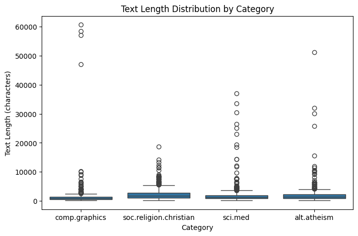
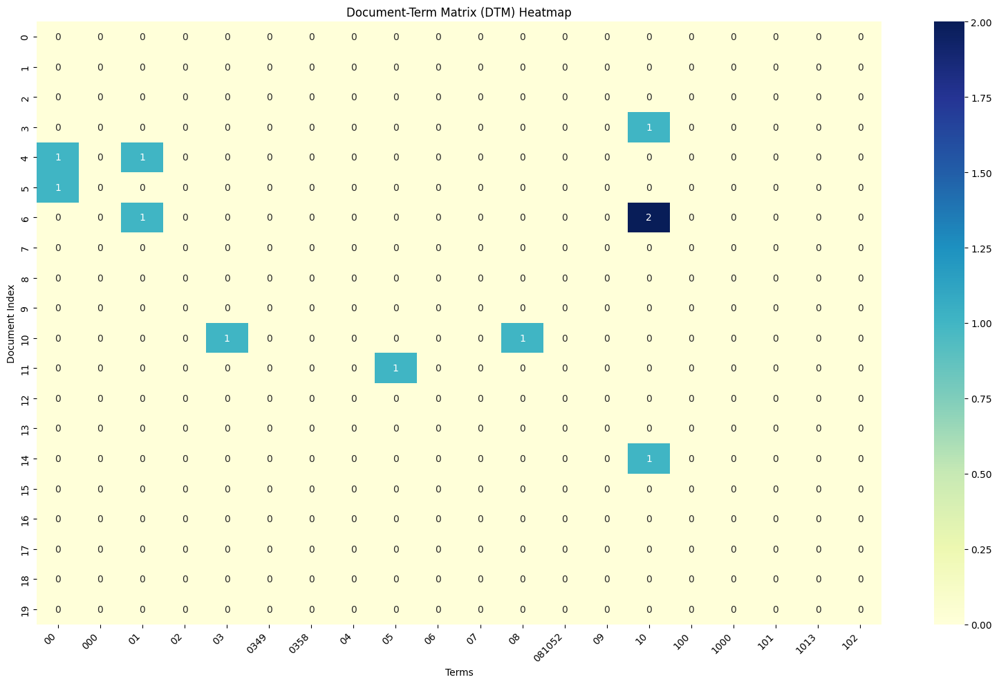
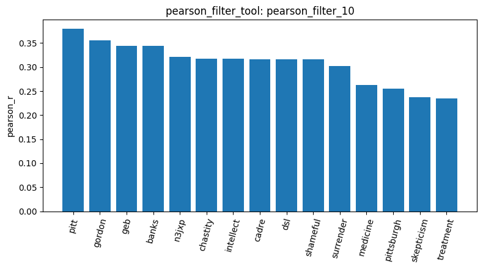
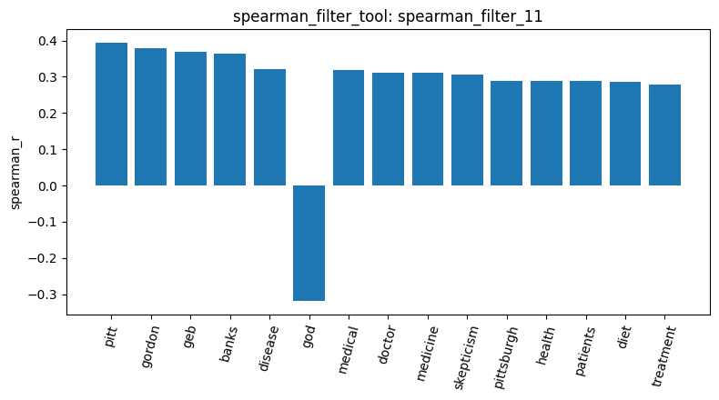
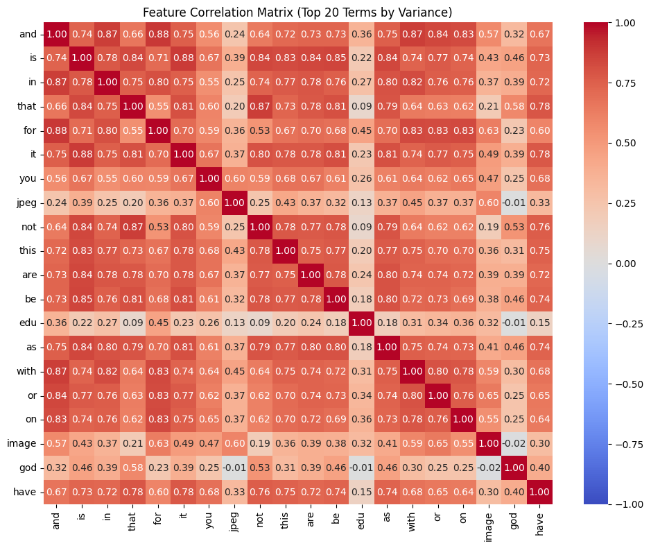
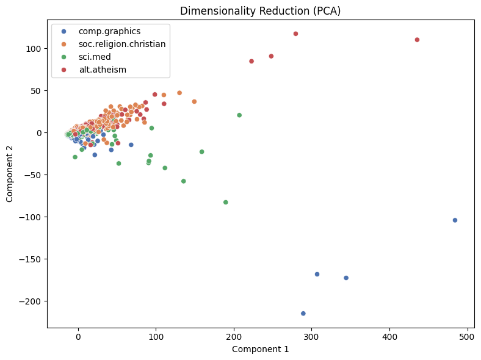

# Agentic pipeline report

鍾佩螢, 113062163

I ran the pipeline on four 20-newsgroups categories in two chat sessions. When I got to pattern mining, `mine_patterns_tool` crashed with a `UnicodeDecodeError`: PAMI writes its files in the Windows default encoding, and some terms have accented letters. I fixed the tool to give PAMI plain ids (`t0`, `t1`, and so on) and map them back to the real terms, then re-launched the chat. A fresh launch restarts the result numbering, so below I say which session each result ID belongs to. Session 1 covers loading through the Pearson and Spearman plots, and session 2 covers the rest. In session 2 I also granted access to my own tools in one batch, as the notebook describes. `load_dataset_1` (session 1) loaded 2,257 posts: 599 `soc.religion.christian`, 594 `sci.med`, 584 `comp.graphics` and 480 `alt.atheism`. `missing_3` found 0 missing texts, and `duplicates_4` found 0 duplicates. That check compares the whole row (text and both label columns), so the same text under two categories would not count. The raw posts still contain their email headers (`inspect_2` shows the `From:` and `Subject:` lines), which matters for several results below.

`describe_5` shows the text length is heavily right skewed. The overall mean is 1,992.961 characters against a median of 1,235, and the longest post has 60,713 characters. `comp.graphics` has the lowest mean (1,557.0839) but the largest standard deviation (4,684.7673) and owns that longest post. I did not open the long posts, so I don't know what they contain. `dtm_6` (session 1; `build_dtm_tool` with `min_df` 5 and `max_df` 0.9) gives 8,604 terms, 307,375 non-zero entries and a sparsity of 98.4172%. In `tf_7` the top terms are `and` (13,017), `is` (12,343) and `in` (11,226), and `the`, `to` and `of` are missing. I think `max_df` 0.9 removed them because they appear in more than 90% of posts, and the agent agreed. `edu` ranks 12th with 4,675, probably from the email addresses in the headers. `dtm_heatmap_8` took the first 20 terms in alphabetical order, which are all numeric strings, so the slice is almost entirely zeros and shows the sparsity but no structure.

`variance_filter_9` with a threshold of 0.01 kept 4,593 terms and removed 4,011. For a term that appears at most once per post the variance is about d / 2,257, so it needs roughly 23 posts to survive. The removed examples include `arthritis` and `darwin`, which are topical words dropped because they are rare across the whole corpus. `pearson_filter_10` (target `sci.med`, threshold 0.1) kept 291 terms and removed 8,313. Its top terms are `pitt` (0.3795), `gordon` (0.3552), `geb` (0.3447) and `banks` (0.3444), followed by `chastity`, `intellect`, `cadre`, `dsl` and `shameful` at 0.3166 to 0.3174. These read like one frequent poster's name and signature, and the near-identical values suggest they sit in the same posts. I haven't checked the raw text to confirm that. `spearman_filter_11` used the same class and threshold but only scored the 1,500 highest-variance terms and kept 197. The rare signature words never made that cut, which is the main reason its top list is different: `disease` (0.3201), `medical` (0.3186), `doctor` (0.3122) and `medicine` (0.3117), plus `god` at -0.3191. So the two lists are not a like-for-like comparison. The agent first blamed count outliers for the difference. I pointed out the 1,500-term limit, and it agreed. Both bar charts come from `visualize_result_tool`, and their file names use turn numbers instead of result IDs.

`feature_correlation_12` covers the 20 highest-variance terms. Function words correlate strongly with each other (`and` with `for` at 0.8833, `is` with `it` at 0.8795), which I read as a document length effect because long posts contain more of every word. Topical words behave differently: `jpeg` and `image` correlate at 0.5998, while `god` and `jpeg` are at -0.0070. The agent agreed that raw counts mix length with content. In session 2, `mine_patterns_3` mined `sci.med` with FP-Growth at a minimum support of 150, about 25% of its 594 posts, and returned 257 patterns. The top ones are header words: `subject` (support 594, every post in the category), `lines` (585), `organization` (582) and `edu` (416). A higher support would only make the header words win by more, so the headers or their terms would have to be removed before mining, which I did not do in this run.

`reduce_dimensions_4` (PCA, two components) explains 48.7064% and 7.2309% of the variance, 55.9372% together. That is high for a sparse count matrix, and I think the first component mostly tracks post length. The agent agreed, but I did not test it with normalized counts. In the plot, most posts sit in one overlapping cluster near the origin, a few very long posts stretch far along component 1, and the four categories are not cleanly separated. `binarize_labels_5` produced a 2,257 by 4 one-hot label matrix. For cosine similarity, `cosine_similarity_6` compares documents 0 and 1, both `comp.graphics`, and gives 0.1509. `cosine_similarity_7` compares documents 0 and 2 (`comp.graphics` and `soc.religion.christian`) and gives 0.1180. Both values are low because each post uses only a small part of the 8,604-term vocabulary. The cross-category pair is lower, but two pairs and a gap of 0.0329 are not enough to say same-category posts are more similar. That claim would need many pairs and per-category averages. Finally, `sample_8` drew 200 rows without changing the original data, `tokenize_9` extracted 903,209 tokens, and `list_files_10` listed the six saved plots.

