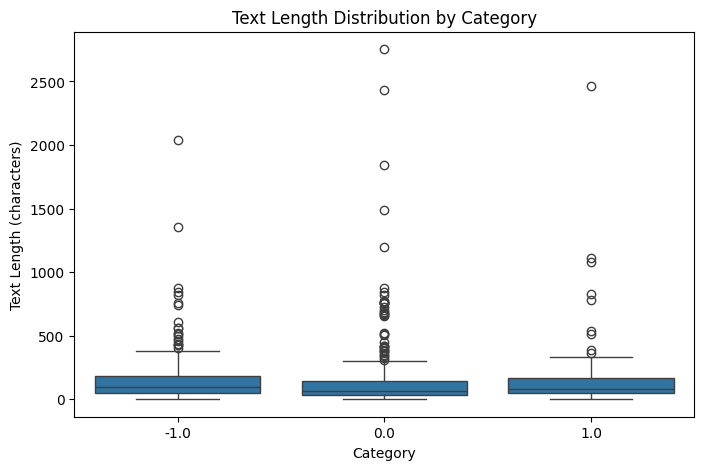
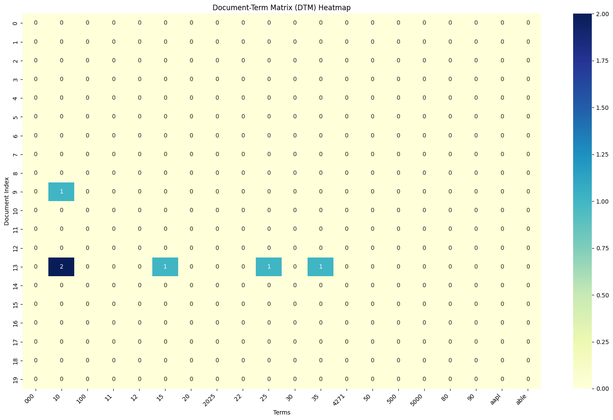
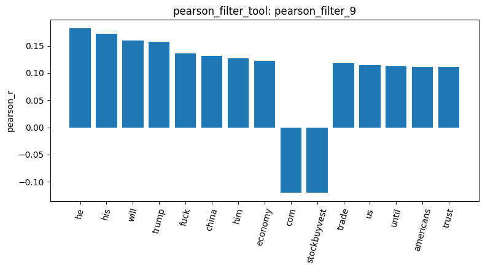
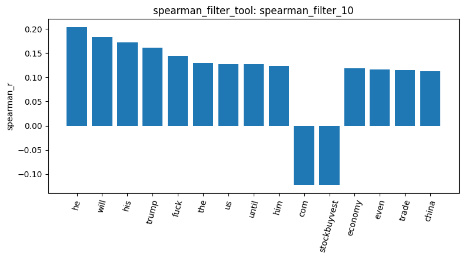
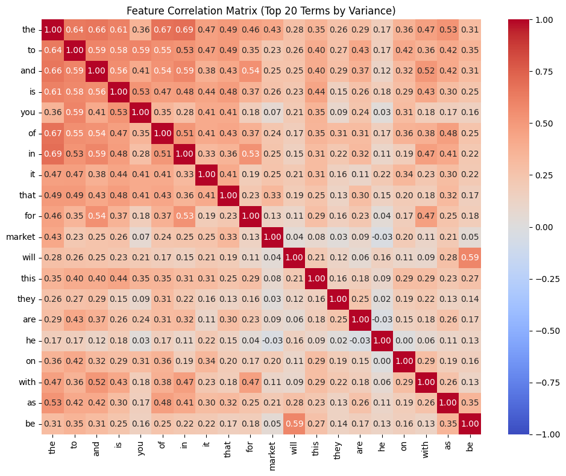
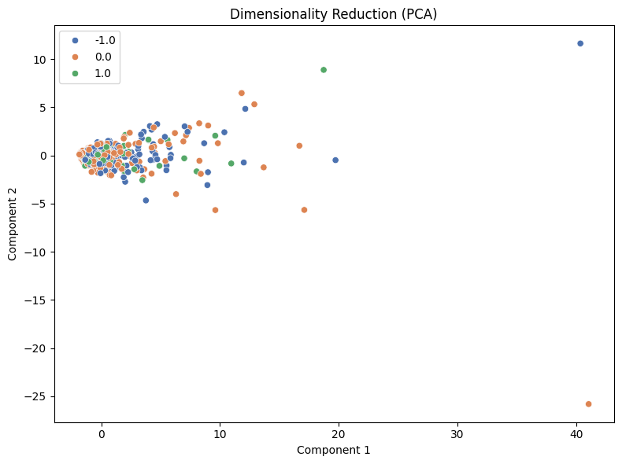

# Homework report: Reddit stock sentiment

鍾佩螢, 113062163

I ran the pipeline on `newdataset/Reddit-stock-sentiment.csv` in one chat session, so every result ID below comes from the same log. `load_dataset_1` loaded 847 comments with three sentiment labels: 423 labeled `0.0` (neutral), 315 labeled `-1.0` (negative) and 109 labeled `1.0` (positive), which is 49.9%, 37.2% and 12.9%. `missing_3` found 0 missing texts. It only looks at the text column, so a one-character comment still counts as present. `duplicates_2` found 23 duplicate rows, with 847 rows remaining because I ran it without dropping. I kept the duplicates. The count of 23 only counts the extra copies, while the drop option removes every copy, so dropping would have removed at least 24 rows and 46 if every group is a pair. The summary does not show how the duplicates are grouped, and short identical comments can be real posts from different users. The agent contradicted itself on this at first, and I asked it again until it gave those numbers. `describe_4` shows that the comments are short and skewed: mean 148.68 characters, median 79, minimum 1, maximum 2,753. The mean is 153.74 for `-1.0`, 140.79 for `0.0` and 164.64 for `1.0`.

`dtm_5` (`build_dtm_tool` with `min_df` 3 and `max_df` 0.9) has 1,099 terms, 13,334 non-zero entries out of 930,853 and a sparsity of 98.57%. I chose `min_df` 3 instead of 5 because the corpus has only 847 short comments. `tf_6` lists `the` (920), `to` (566), `and` (488), `is` (402) and `it` (350) as the top terms. `the` survives `max_df` 0.9 because that setting looks at the number of documents containing a word, and many short comments do not contain `the`. `dtm_heatmap_7` shows the first 20 terms alphabetically, which are mostly numbers (`000`, `100`, `2025`, `5000`) plus `aapl` and `able`, and only documents 9 and 13 have a non-zero cell, so it shows the sparsity but no structure. `variance_filter_8` with a threshold of 0.005 kept 699 terms and removed 400. A term that appears at most once per comment needs at least 5 of the 847 comments to pass. The removed terms include `amazon` and `amzn`, which are stock names, so filtering by variance before looking at the labels throws away rare but meaningful words.

For the negative class I compared `pearson_filter_9` and `spearman_filter_10`, both with target `-1.0` and threshold 0.05. Pearson kept 308 terms and removed 791. Spearman kept 321 and removed 778. The vocabulary has fewer than 1,500 terms, so Spearman scored every term and the comparison is fair. Seven terms are in both top 10 lists: `he` (0.1825 Pearson, 0.2043 Spearman), `his`, `will`, `trump` (0.1572 and 0.1614), `fuck`, `him` and `com`. Pearson also lists `china`, `economy` and `stockbuyvest`, and Spearman lists `the`, `us` and `until`. Most of these are topic words or pronouns, not sentiment words, so correlation picks up what negative comments talk about as well as how they feel. `com` and `stockbuyvest` have the same Pearson value (-0.1202), so they most likely appear in exactly the same comments, probably one repeated link. They should then tie in Spearman too, and `stockbuyvest` is most likely just the 11th term, cut off because the summary shows only 10. I could not confirm this from the log. With 847 comments a correlation needs an absolute value of about 0.0673 to be significant at the 5% level, so some terms between 0.05 and 0.0673 that my threshold kept are not significant. The two bar charts come from `visualize_result_tool`, and their file names use turn numbers.

`feature_correlation_11` covers the 20 highest-variance terms. Function words correlate strongly with each other (`in` and `the` 0.6943, `of` and `the` 0.6727, `and` and `the` 0.6623), which I read as a comment length effect. `will` and `be` correlate at 0.5886, probably from the phrase "will be", and `he` is close to zero with `market` (-0.0261). For pattern mining, `mine_patterns_12` used the variance filter, which the agent picked on its own, and found 0 patterns at a minimum support of 25. I asked for a rerun with `tfidf` and a support of 8 (2.54% of the 315 negative comments). `mine_patterns_13` found 58 patterns, led by `trump` (45), `just` (42) and `china` (33). The chat summary only lists the top 10, which are all single words. The agent claimed that many of the rest were word pairs, which it could not know from that summary, so I do not report how many patterns have more than one word. The top patterns match the correlation results, since `trump` and `china` are also top terms there.

`reduce_dimensions_14` (PCA, two components) explains 31.52% and 5.45% of the variance, 36.97% in total. That is high for a sparse matrix, and I think the first component mostly follows comment length, since a few very long comments sit far out on it, up to about 41. The three sentiment classes overlap completely in the plot. `binarize_labels_15` gives an 847 by 3 one-hot matrix with classes `-1.0`, `0.0` and `1.0` and counts 315, 423 and 109. `cosine_similarity_16` compares documents 1 and 2, both neutral, and gives 0.2037. `cosine_similarity_17` compares documents 1 and 16 and gives exactly 0.0. `inspect_18` shows that document 16 is the two-word comment "Jesus Christ", and both words fell below `min_df` 3, so its row in the matrix is all zeros. The 0.0 therefore comes from an empty vector and does not say the two comments are dissimilar. Two cosine values are not enough to compare similarity within and across classes, so I draw no conclusion about that. `sample_19` drew 100 comments with `random_state` 42 and `tokenize_20` extracted 26,386 tokens from the 847 comments.

